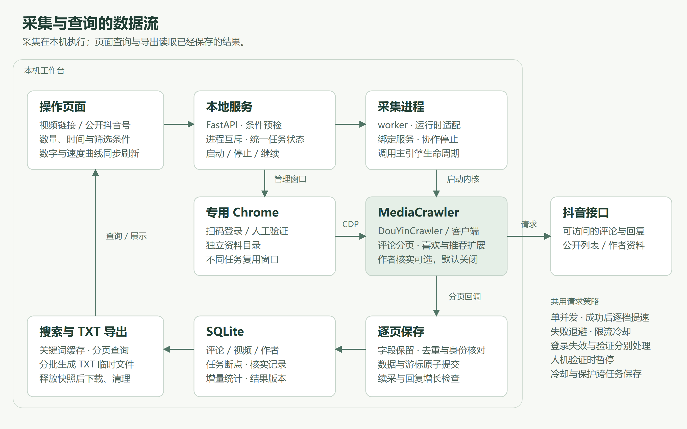
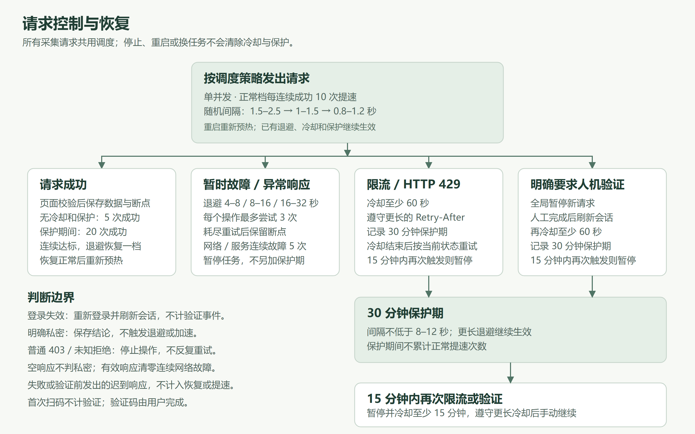

# 采集原理



## 任务如何执行

1. 页面提交视频链接或公开抖音号。FastAPI 检查采集条件，再创建任务并记录数量和时间范围。当前不支持的点赞时间条件在创建、启动和内核入口检查，避免为已知无法完成的任务请求平台。
2. 服务进程管理专用 Chrome，采集 worker 通过 MediaCrawler 的 CDP 管理器连接。使用独立资料目录，任务结束只断开连接，窗口供后续任务复用。
3. worker 进入 `backend.engine.run_engine`，调用 `DouYinCrawler(runtime=...).start()`。运行时适配器接入登录、任务分发和本地存储。
4. 评论通过内核客户端读取主评论和每条评论的回复；喜欢、推荐通过内核扩展分页。账号与作者资料核实共用客户端和会话。结果作者的资料补齐为可选步骤，新任务默认关闭；目标账号的定位与权限检查仍会执行。
5. 分页回调先归一字段，再把该页数据和下一页游标写入同一个 SQLite 事务。中断后从已提交的断点继续。
6. 页面查询和 TXT 导出读取 SQLite。评论无关键词时在数据库筛选、分页；有关键词时首次分批匹配，后续同条件查询复用匹配 ID，只读取当前页。页面根据任务更新时间刷新。关键词匹配使用归一后的搜索副本，展示和导出保留原文。

## 上游与本项目的边界

| 部分 | 位置与职责 |
| --- | --- |
| MediaCrawler 主引擎 | `vendor/MediaCrawler/media_platform/douyin/core.py`：生命周期、登录与分页入口 |
| MediaCrawler 客户端 | `client.py`、`help.py`：请求准备与签名；签名算法保持固定版本 |
| 兼容补丁 | `vendor/patches`：显式运行时接口、分页回调、断点、人工登录回调、CDP 附着 |
| 本地运行时 | `backend/engine.py`：调用引擎、共享会话和任务分发 |
| 功能扩展 | `backend/engine_tasks.py`：评论任务、喜欢、推荐、作者身份核实 |
| 存储适配 | `backend/engine_storage.py`、`db.py`：字段归一、逐页提交和断点 |
| 任务统计 | `backend/task_stats.py`：随数据事务维护数量、待核实作者及结果版本；`check_stats.py` 提供离线检查和重建 |
| 任务状态 | `backend/task_state.py`：统一启动、登录等待、完成、停止和异常退出的状态转换 |
| 请求与会话 | `backend/responses.py` 统一响应分类；`douyin_adapter.py`、`stable_policy.py`、`browser_session.py` 处理请求、节奏与会话 |
| 搜索与导出 | `backend/search.py`；前端只发送筛选条件和展示结果 |
| 关键词缓存 | `backend/search_cache.py`：服务进程内保存有序匹配 ID、匹配类型及分数，按任务结果版本失效 |

旧采集器保留作回归比较，生产入口不会在新内核失败时回退。喜欢与个人主页推荐是本项目扩展，不是上游已有的完整采集模式。

固定上游版本为 `5d547f45862ca2d4b404e5a51775879d579b29d4`，补丁版本为 `workbench.2`。启动前校验七个变更文件的字节哈希。仓库因此保留这些文件的原始换行形式，避免 Windows 检出时改变校验结果。

## 请求策略

下图的 2–4 秒为每次启动时的初始档位，正常运行后按下表逐步提速。



所有采集请求经过同一调度器，最多同时发出一个请求。限速只在 HTTP 请求边界执行一次，分页不再叠加固定等待。先处理 HTTP 状态，再判断明确的业务提示；一份响应只记一次控制结果。分页字段校验通过后才计入成功，避免结构异常的数据先加速再退避。

| 情况 | 处理 |
| --- | --- |
| 正常请求 | 从随机 1.5–2.5 秒开始，每连续成功 10 次，依次缩短至 1–1.5 秒、0.8–1.2 秒 |
| 暂时网络／服务故障 | 依次退避 4–8、8–16、16–32 秒；无冷却或保护时连续成功 5 次恢复一档，保护期间仍需 20 次 |
| 连续 5 次暂时网络／服务故障 | 暂停本次采集并保留断点，不额外建立风控保护期；有效响应清零连续失败计数 |
| 空响应或结构异常 | 同样退避和恢复，每次操作最多尝试 3 次，不据此认定验证码或私密列表 |
| 不可重试错误 | 普通 403、其他不可重试 HTTP 错误或未知业务失败立即结束本次操作，保留断点 |
| 重试上限 | 每次可重试操作最多尝试 3 次；请求耗尽重试后不通过重置游标再次请求 |
| 登录失效 | HTTP 401 和明确登录提示统一等待重新登录，刷新会话后继续，不记为验证码事件 |
| 明确私密列表 | 保存私密结论，不触发退避或加速；未知状态码不能用于猜测列表权限 |
| HTTP 429 或明确限流提示 | 至少冷却 60 秒，遵守更长的 `Retry-After` |
| 明确需要人机验证 | 暂停新请求，人工完成后刷新会话，再冷却 60 秒 |
| 限流或人机验证之后 | 进入 30 分钟保护期，间隔至少 8–12 秒 |
| 15 分钟内再次触发 | 暂停任务并冷却 15 分钟，到期后由用户继续 |

冷却与保护状态保存在 `data/collection-control.json`，停止、换任务或重启不会重置。首次扫码和登录过期后的重新登录均不计为风控事件。若等待登录期间又明确要求人机验证，登录恢复后仍须等待人工处理。

连续网络故障计数只属于当前采集进程，普通退避不会清除已经存在的风控冷却。请求结果日志仅记录固定类别和次数，不保存响应正文。

加速档位不跨进程保存。失败后重新计数，退避恢复正常后从初始档预热；保护期内不累计加速次数。失败或验证前发出的迟到响应不计入恢复。日志分别记录主评论、回复、列表与作者核实阶段的请求、等待、写入和耗时。

会话检查和 Cookie 刷新缓存 30 秒，启动和人工验证后强制刷新。签名前复制参数与请求头，签名和发送使用同一快照。请求资料合并只作用于同一运行期间，每位作者的身份仍分别核对。

## 时间与完整性

评论按发布时间排序和筛选。喜欢／推荐保留平台列表顺序，数量限制按筛选后的视频 ID 去重计算；时间条件使用行为时间。视频发布时间只用于展示和导出。

缺少可靠点赞时间时不能按点赞时间筛选。推荐时间只接受目标用户身份匹配且没有冲突的标签。未知时间不会被静默跳过后标为完整。

分页完成与作者核实完成分别记录。数量上限、隐私限制、接口错误和人工停止都有独立状态；现有结果可以导出，但不代表覆盖所有内容。

任务的 `verify_authors` 控制采集结束后是否补齐作者抖音号。新任务默认关闭，历史任务迁移时保留开启；暂停后可以通过任务选项修改。单独核实只补齐已保存记录，不读取列表页面、不改变断点，也不改变该选项。关闭核实时保留接口提供的公开抖音号，缺失字段导出为「未提供」。

## 结果快照与停止状态

同一数据目录通过操作系统文件锁分别保护服务和 worker。服务在生命周期启动阶段取得独占锁，确认旧 worker 已退出后才初始化数据库和恢复中断任务；导入模块不再打开数据库。锁文件保留在本地，进程退出由操作系统释放锁，不靠删除锁文件或复用旧 PID 判断归属。

worker 启动时校验所属服务的实例标识，运行中约每 200 毫秒检查服务归属和停止标记。采集扩展、请求调度和传输层共用缓存后的停止信号，避免重复读取数据库。服务还持有独立停止管道，关闭管道即可通知 worker，迟到的登录成功回调不能撤销停止指令。服务退出或用户停止会取消等待中的操作，保留已经原子提交的页面和断点。直接运行 worker 也需要取得独占权，不能与正在运行的服务共用数据目录。

服务在后台检查自己启动的 worker 和 Chrome，即使没有页面轮询也能发现退出。Chrome 或采集页关闭后，登录状态失效，重新打开时重新检查会话。正常结束 worker 只断开连接，服务继续持有 Chrome，后续任务复用窗口。若服务崩溃后专用 Chrome 仍在运行，新服务提示关闭原专用窗口后再试；不会按保存的 PID 或端口接管、结束未知进程。

单个任务查询和结果页使用显式 SQLite 读取事务。评论、喜欢、推荐的记录、总数、待核实数量与完成状态取自同一快照；读取期间即使 worker 提交新页面、补齐作者或任务被删除，当前响应仍保持一致，下一次查询才看到更新。视频结果接口增加可选的待核实数量和核实完成状态字段。

任务数量保存在 `task_stats` 中，由数据库触发器随页面写入、作者补齐和删除一起更新。待核实作者按当前结果实际引用的身份分组计数，同一身份有多条未确认记录时只计一位；重复页面、孤立核实记录不会多计。历史任务列表和单个任务摘要只读取任务表与统计表，不再汇总全部结果。

任务和结果页返回独立的 `result_version`。结果字段、作者信息或影响结果的完成状态变化时版本递增，只有进度时间、尝试次数变化或重复写入相同结果时不递增。页面、数量和版本来自同一快照；当前界面的刷新方式保持不变。

评论和按发布时间排列的视频使用时间倒序及 ID 倒序，缺失时间仍排在最后。行为顺序使用采集序号升序，历史缺失序号排在最后，再按原有时间和 ID 排列。排序查询与索引匹配，采集序号最大值也通过索引定位。

TXT 导出复用结果页的读取规则，将记录与采集完成标记一并取得。读取事务在生成下载响应前结束，下载速度不会延长数据库快照的存续时间。字段、排序、编码、换行和未完成提示保持原格式；分批文件导出另行处理。

API、采集扩展和 worker 共用任务状态规则。状态判断与写入在同一个短事务中完成；停止操作等待 worker 退出后再读取最终状态，只将仍处于运行、核实或登录等待的任务收束为暂停，保留已经写入的完成、私密、保护暂停及失败原因。晚到的退出错误或登录回调不能覆盖完成、私密和暂停结论。只有明确启动新一轮操作才进入运行或核实状态；worker 内部开始阶段不会清除用户已经发出的停止请求。

写入操作收到非法端口、不完整主机或重复的 `Origin` 时返回 403；无效时间和当前系统无法转换的时间返回 400，不泄露底层异常。

## 关键词查询缓存

缓存键包含任务 ID、结果版本、账号、关键词、匹配方式、阈值及解析后的时间边界。首次查询仍按原规则筛选账号和时间，再执行繁简转换与模糊匹配。缓存只保存有序匹配 ID、匹配类型及分数，不复制评论正文；总数取匹配 ID 的数量，翻页时按 ID 分批读取并格式化当前页。空匹配同样可复用，改动条件会重新查询。

缓存属于当前服务实例，最多保留 64 组条件，总预算 32 MiB，单组预算 16 MiB。预算按对象大小加容器余量估算，包含正在构建的匹配列表；超出总预算时淘汰最近最少使用的条目，单组超限则放弃保存并继续完整查询。只允许一个查询构建缓存，其他并发未命中查询正常执行，避免同时保留多份大列表。该预算不代表整个进程的内存上限。

结果页先在 SQLite 快照内读取版本，再查找同版本缓存。采集写入或作者补齐后，新版本查询淘汰旧条目；旧快照仍能读完自己的结果，但不能替换较新的缓存。首次匹配结束时再次核对最新已提交版本，已更新或删除的任务不再接纳旧匹配列表。任务删除会清理对应缓存及正在构建的列表，服务退出时清空缓存，重启后重新建立。缓存不写入数据库，也不跨采集进程共享。

TXT 导出可以复用同条件的匹配列表，仍按当前读取快照取正文和作者信息，保留原有字节格式。无关键词查询继续使用数据库筛选与分页。首次搜索、超限查询以及结果持续变化时仍需要重新匹配，不保证这些情况获得相同的翻页提速。

## 目标账号定位

历史主页只作定位线索，使用前重新读取资料，核对用户标识和公开抖音号。资料接口明确返回 HTTP 404／410，或当前资料已不匹配该账号时，跳过这条线索；没有可确认的历史候选时进入正常搜索。搜索结果也要再次核对主页资料，不能用昵称或内部用户编号替代公开抖音号。

网络故障、登录失效、未知访问拒绝、限流、人机验证和结构异常沿用请求控制流程，不视为账号不存在，不绕过失败继续搜索。续采任务已有目标主页时，只复核该主页；主页失效或抖音号发生变化便停止并保留结果，防止把其他账号的视频混入原任务。

点赞时间条件的预检由 `backend/preflight.py` 共用。旧任务带有该条件时，启动和重新采集均返回明确错误，原结果和断点不变。单独核实作者只处理已保存结果，不受这项采集条件限制。

## 作者核实

评论、喜欢、推荐使用 `backend/verification.py` 中的同一套判断。每条结果在 `author_verifications` 中保存采集时的身份依据与核实结果，不再从一组视频中选出最大的 `uid`、`sec_uid` 作为代表。即使多条记录共享主页标识，也要逐条核对；资料中的已知标识与其中一条记录冲突，只将那条记录标为冲突。

同次运行中，同一主页只查询一次原始资料。采集结果已经提供的公开抖音号也可用于核对本任务内的缺失记录，但必须有一致的用户标识，不能靠昵称匹配。资料回写前再次比较记录的原始身份，防止迟到响应写入已经更换身份的结果。页面数据、原始身份记录与游标在同一事务中保存。

| 核实状态 | 含义 |
| --- | --- |
| `pending` | 尚未核实 |
| `confirmed` | 采集结果已提供公开抖音号，或资料通过身份核对 |
| `no_query` | 缺少查询主页所需的标识 |
| `not_provided` | 资料没有提供可确认的身份或公开抖音号 |
| `request_failed` | 请求失败、人工验证、保护暂停或取消 |
| `conflict` | 用户标识存在冲突，不能套用该资料 |

每条身份记录保存失败类别、尝试次数与最近尝试时间。次数按一次资料查询操作计算，操作内的重试另计入网络请求统计；共用一次资料响应的记录各记一次尝试。无需请求的本地核对不增加次数。停止后保留已经确认的结果，下次只处理未确认记录。

`verification_complete` 只表示当前已保存结果没有未确认作者，不再要求内容已采集完毕；空结果无须核实。无查询条件、资料未提供、失败与冲突仍计入待核实数量。单独核实不会清除原采集错误、改动游标或数量上限；核实中重新登录或进程退出时，也保留原采集错误。历史已确认资料仍可作为目标主页的定位线索，使用前须重新核对。

## 分页续采与回复增长

普通请求失败和结构异常沿用保存的游标。非结束页连续三次为空、重复或游标停滞时，保存本页已获得的数据但不推进游标，并以未完成状态结束。重复页按本次线程采集已见过的评论／视频 ID 集合判断，缺失游标和游标循环同样不能视为正常结束。明确的结束页仍以接口结束标志为准。

当前固定接口没有经过验证的游标失效分类，因此不自动从第一页重放。这样也避免把新出现的喜欢／推荐视频追加到旧批次末尾，打乱行为顺序。原断点无法继续时保留结果，由用户决定是否新建任务。

回复断点记录见过的最高声明数量和完成时已保存的独立回复条数。主评论声明数量超过已记录的最高值，或内嵌预览带来此前未保存的回复 ID 时，已完成线程从头重新检查；这些观察、页面数据和断点在同一事务中保存。已经开始重查的线程保留当前进度，后续数量变化不再重置它。声明数量回落、重复预览以及声明数量与实际条数不一致，都不会单独触发反复重查。

这项判断只使用正常采集过程中获得的新证据，不主动轮询已经完成的历史任务。回复内容或作者字段的补齐不会单独触发增长判断。

## 数据库升级与恢复

数据库结构由 `backend/migrations.py` 管理，版本保存在 SQLite 的 `PRAGMA user_version`。没有版本记录的历史库按版本 0 接管；版本 1 保留当前字段、结果、核实选项及断点。新建任务仍默认关闭作者核实，缺少该选项的旧任务保留原来的开启行为。

版本 2 在断点表增加 `reply_count_seen`、`reply_rows_seen`，并增加 `(task_id,parent_id)` 评论索引。历史评论回复断点以库内现有声明数量和已保存条数作为初始观察依据；原游标、完成状态和重启次数保持不变，不推断以前漏掉了多少回复。喜欢、推荐断点不补写回复观察字段。未采集过的历史变化无法据此还原。

版本 3 记录评论正文来源，修复有明确身份依据的临时作者关联。版本 4 新增逐条作者核实记录，保留原评论、视频、作者与断点数据。旧作者资料只有在已知标识不矛盾时才用于对应评论；旧视频分组存在矛盾标识时转为待核实。历史尝试次数无法还原，初始化为 0，最近尝试时间为空。

版本 5 从现有结果建立任务统计和待核实身份分组，增加排序索引与事务内更新触发器。历史任务的结果版本从 0 开始，原结果、断点和字段不变。启动时校验统计触发器，缺失或被改写时停止启动。

需要检查统计时，先正常退出工具，再运行：

```powershell
.\.venv\Scripts\python.exe -m backend.check_stats --db data/comments.sqlite3
```

该命令比较保存的统计与实际记录，不自动重建。确认需要修复后可增加 `--rebuild`；重建只修改统计和身份分组，并递增结果版本，不改采集结果和断点。工具取得与服务、worker 相同的独占锁，运行中的程序会阻止维护。旧版本数据库仍先按正常迁移流程备份、升级。

有待执行的迁移时，程序先取得 SQLite 写锁，再通过备份接口保存已提交的数据，包括尚在 WAL 中的内容。默认备份位置为 `data/backups/<数据库名>.v旧版本-v新版本.<UTC时间>-<随机后缀>/backup.sqlite3`；使用自定义数据目录时，备份放在数据库同级的 `backups/` 中。新建空库和版本未变化的重复启动不生成备份，程序不清理已有备份。失败时留下的 `backup.incomplete` 不是可用备份。

全部待执行迁移在同一个事务内运行，字段、索引、数据调整和版本号一起提交。备份、迁移或校验失败会阻止服务启动；迁移中断时未提交的修改回滚。遇到高于程序支持范围的版本，或已标记版本的库缺少必要结构时，停止启动并报错，不自动重建表。WAL 配置在迁移提交后设置，配置失败同样停止启动，但已完成的版本升级会保留。

需要恢复时，先退出服务和采集进程。保留当前数据库及其 `-wal`、`-shm` 文件，再把选定的 `backup.sqlite3` 用 SQLite 备份接口恢复到一个新的数据库文件，校验 `PRAGMA quick_check` 并检查任务、结果和断点。确认后才替换原库，不能把旧库的 WAL 文件与恢复后的文件混用。重新启动时会按备份内的版本再次迁移，并另存一份升级前备份。数据库备份不包含浏览器登录目录和 `collection-control.json`，恢复数据库不会重置这些文件。

后续结构变更和历史数据修复都在 `MIGRATIONS` 末尾追加连续版本，同时更新结构检查和迁移测试。迁移函数只执行事务内的 SQL，不自行提交、切换日志模式或调用会隐式提交的 `executescript`。不要修改已发布迁移来替代新版本。

## 图片源文件

README 使用 PNG，便于直接在 GitHub 查看。可编辑源文件为 [architecture.svg](images/architecture.svg) 和 [request-policy.svg](images/request-policy.svg)，不依赖外部图片服务。
